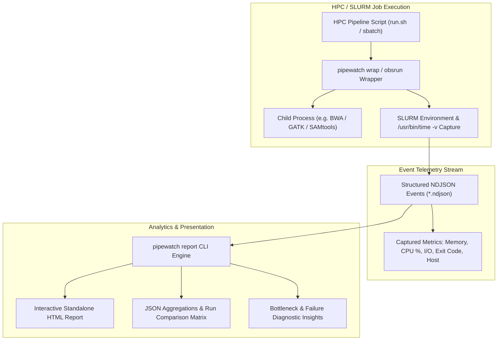

# 🔬 Pipewatch

**Pipeline observability for legacy Slurm-based bioinformatics workflows**

[](https://github.com/BurakBulut-sh/pipewatch/actions)
[](https://www.python.org/downloads/)
[](https://opensource.org/licenses/MIT)

Pipewatch brings modern observability to legacy HPC pipelines without requiring migration to workflow managers like Nextflow or Snakemake. It wraps your existing `run.sh` scripts and provides clear insights into runtime, resource usage, and failure patterns.

## Why Observability Matters for HPC Pipelines

Bioinformatics pipelines often run for hours or days across hundreds of samples. When things go wrong:

- **Which step is the bottleneck?** ⏱️
- **Which samples keep failing?** 🔥
- **Are we requesting enough memory?** 🧠
- **Did the latest code change slow things down?** 📉

Traditional approaches require either:
1. **Painstaking manual log parsing** across thousands of files
2. **Full workflow manager migration** (Nextflow, Snakemake, WDL) — expensive and disruptive

**Pipewatch provides a middle path**: add observability to your existing Bash scripts in minutes.

## Quick Start

```bash
# Install pipewatch
pip install pipewatch

# Wrap your existing script (generates instrumented version)
pipewatch wrap run.sh -o run_instrumented.sh

# Run your instrumented pipeline
sbatch run_instrumented.sh samples.txt reference.fa

# Generate report
pipewatch report pipewatch-events/*.ndjson -o report/

# View the HTML report
open report/index.html
```

## Architecture



Pipewatch consists of two main decoupled components:

### A. `obsrun` — Lightweight Bash Wrapper

A pure Bash wrapper script that:
- Wraps arbitrary commands and pipeline steps
- Emits structured events in NDJSON format
- Automatically captures SLURM environment variables (`SLURM_JOB_ID`, `SLURM_NODELIST`, `SLURM_CPUS_PER_TASK`)
- Records process peak memory and CPU utilization via `/usr/bin/time -v`
- Enforces `set -euo pipefail` for immediate and precise error propagation

```bash
# Direct usage
obsrun "bwa mem ref.fa reads.fq | samtools sort -o out.bam"

# With metadata
PIPEWATCH_STEP_NAME=align PIPEWATCH_SAMPLE_ID=S001 obsrun "your_command"
```

### B. `pipewatch report` — Analysis & Reporting

A Python CLI and templating engine that:
- Ingests single or distributed NDJSON event streams
- Aggregates runtime statistics, step durations, and memory peaks across samples
- Generates interactive, standalone HTML dashboards (with charts and tables)
- Exports clean JSON summaries for CI/CD assertions and pipeline regression testing
- Detects memory bottlenecks and job failures across HPC nodes

## Installation

### From PyPI (recommended)

```bash
pip install pipewatch
```

### From Source

```bash
git clone https://github.com/BurakBulut-sh/pipewatch.git
cd pipewatch
pip install -e ".[dev]"
```

### Docker

```bash
docker build -t pipewatch .
docker run -v $(pwd)/reports:/app/reports pipewatch
```

## CLI Reference

### `pipewatch wrap` — Instrument a Script

Generate an instrumented copy of your `run.sh` by rewriting `srun` calls:

```bash
pipewatch wrap run.sh -o run_instrumented.sh
```

Options:
- `--output, -o`: Output path (default: `{input}.instrumented.sh`)
- `--step-prefix`: Prefix for auto-detected step names (default: `step`)
- `--obsrun-path`: Path to obsrun executable

### `pipewatch run` — Execute Under Observation

Run a command with full observability:

```bash
pipewatch run --step-name align \
    "bwa mem ref.fa reads.fq | samtools sort -o out.bam"
```

Options:
- `--output, -o`: Event file path (default: `pipewatch-events.ndjson`)
- `--step-name`: Name of the step
- `--sample-id`: Sample identifier
- `--capture-resources/--no-capture-resources`: Enable resource capture (default: enabled)

### `pipewatch report` — Generate Reports

Ingest event files and produce reports:

```bash
# Single run
pipewatch report events.ndjson -o report/

# Multiple runs
pipewatch report runs/*.ndjson -o report/

# With comparison
pipewatch report current.ndjson -o report/ --compare-with baseline.ndjson
```

Options:
- `--format`: `html`, `json`, or `both` (default: `both`)
- `--compare-with`: Baseline event file for comparison

## Instrumenting Your Pipeline

### Method 1: Using `pipewatch wrap` (Automated)

```bash
# Generate instrumented script
pipewatch wrap run.sh -o run_observed.sh

# Review and adjust
vim run_observed.sh

# Submit to Slurm
sbatch --array=1-100 run_observed.sh
```

### Method 2: Manual Instrumentation

Add the `obsrun` wrapper function to your script:

```bash
# At the top of your script
OBSRUN_PATH="${OBSRUN_PATH:-$(which obsrun)}"
export PIPEWATCH_EVENTS_FILE="./pipewatch-events/run.ndjson"

# Wrapper function
run_observed() {
    local step_name="$1"
    shift
    if [ -x "$OBSRUN_PATH" ]; then
        PIPEWATCH_STEP_NAME="$step_name" \
        PIPEWATCH_SAMPLE_ID="${SLURM_ARRAY_TASK_ID:-}" \
        "$OBSRUN_PATH" "$*"
    else
        eval "$*"
    fi
}

# Use it for each step
run_observed "align" "bwa mem ref.fa R1.fq R2.fq | samtools sort -o out.bam"
run_observed "markdup" "samtools markdup in.bam out.bam"
```

### Method 3: Using `pipewatch run` in Slurm Scripts

```bash
#!/bin/bash
#SBATCH --array=1-100

SAMPLE=$(sed -n "${SLURM_ARRAY_TASK_ID}p" samples.txt | cut -f1)

pipewatch run \
    --step-name align \
    --sample-id "$SAMPLE" \
    --output "events/${SAMPLE}.ndjson" \
    "bwa mem ref.fa ${SAMPLE}_R1.fq ${SAMPLE}_R2.fq | samtools sort -o ${SAMPLE}.bam"
```

## Event Schema

Events are emitted as NDJSON (newline-delimited JSON) with the following schema:

```json
{
  "schema_version": "1.0.0",
  "event_type": "end",
  "timestamp": "2024-01-15T10:30:00.123456",
  "hostname": "node01.cluster",
  "cwd": "/scratch/user/project",
  "command": "bwa mem ref.fa reads.fq",
  "exit_code": 0,
  "step_name": "align",
  "sample_id": "S001",
  "slurm_job_id": "12345",
  "slurm_array_task_id": "1",
  "slurm_job_name": "my_pipeline",
  "git_commit": "abc123def456",
  "git_branch": "main",
  "duration_ms": 45000,
  "max_rss_kb": 4194304,
  "user_time_s": 42.5,
  "sys_time_s": 2.3,
  "wall_time_s": 45.0,
  "stdout_path": "/scratch/logs/job_12345.out",
  "stderr_path": "/scratch/logs/job_12345.err"
}
```

## Report Interpretation

The HTML report answers key observability questions:

### Top Slowest Steps
Identifies bottlenecks across your pipeline. Steps are ranked by average duration with visual distribution bars.

### Per-Sample Runtimes
Shows execution times across array tasks. Quickly spot samples that are outliers (e.g., due to data quality issues).

### Failure Clustering
Groups failures by step and sample to identify patterns:
- Does step X always fail on certain samples?
- Are there common exit codes suggesting specific issues?

### Memory Hogs
Steps ranked by peak memory usage. Use this to optimize resource requests and identify memory leaks.

### Queue vs Run Time
When SLURM accounting (`sacct`) is available, shows queue wait times vs actual execution time.

### Run-to-Run Comparison
Compare two pipeline runs to detect:
- Performance regressions (>10% slower steps)
- New failures
- Resource usage changes

## Examples

See the `examples/` directory for complete workflows:

### 1. Slurm Array BWA + Samtools
```
examples/slurm-bwa-samtools/
├── run.sh              # Original workflow
├── run_instrumented.sh # Instrumented version
└── samples.txt         # Sample manifest
```

### 2. Multi-Step Legacy Workflow
```
examples/multi-step-workflow/
├── run.sh              # Sequential variant calling
└── run_instrumented.sh # With step-level observability
```

### 3. CI Simulation
```
examples/ci-simulation/
├── simulate_pipeline.py # Fast deterministic simulation
└── run_tests.sh        # CI test suite
```

## Requirements

- Python 3.11+
- Bash 4.0+ (for obsrun)
- `/usr/bin/time` (optional, for resource capture)
- `sacct`/`sstat` (optional, for SLURM accounting)

## Development

```bash
# Clone repository
git clone https://github.com/BurakBulut-sh/pipewatch.git
cd pipewatch

# Install in development mode
pip install -e ".[dev]"

# Run tests
pytest

# Run linting
ruff check src/ tests/
mypy src/

# Run CI simulation
cd examples/ci-simulation
bash run_tests.sh
```

## Contributing

Contributions and issue reports are welcome! Please see [CONTRIBUTING.md](CONTRIBUTING.md) for guidelines.

## License

MIT License — see [LICENSE](LICENSE) for details.

## Author & Citation

**Developed by:** Burak Bulut, Ph.D.  
*Bioinformatics Scientist & Computational Biologist*  
GitHub: [@BurakBulut-sh](https://github.com/BurakBulut-sh)  
Email: `burak.buluut@outlook.com`

If you use Pipewatch to monitor your scientific workflows or pipelines, please cite:

```bibtex
@software{bulut2026pipewatch,
  author = {Bulut, Burak},
  title = {Pipewatch: Pipeline observability for legacy Slurm-based bioinformatics workflows},
  year = {2026},
  publisher = {GitHub},
  journal = {GitHub repository},
  url = {https://github.com/BurakBulut-sh/pipewatch}
}
```

---

**Made with ❤️ for the bioinformatics community**
